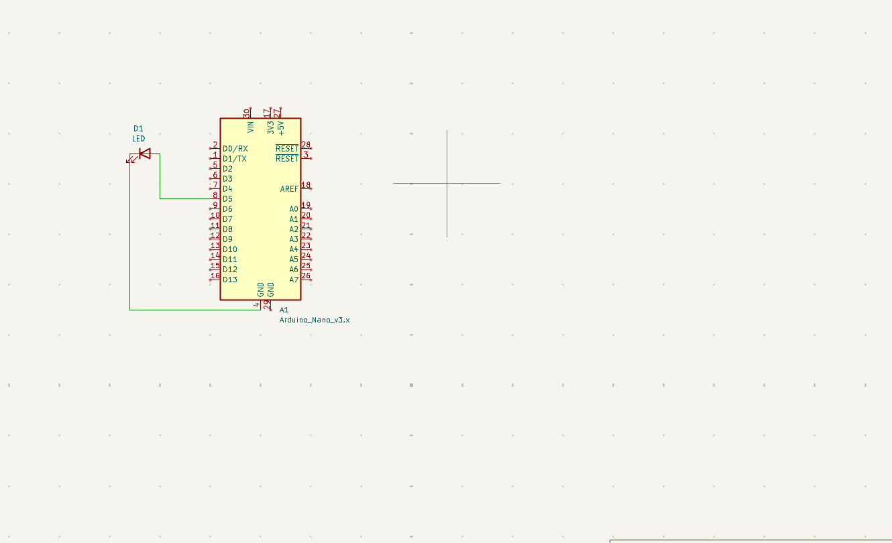
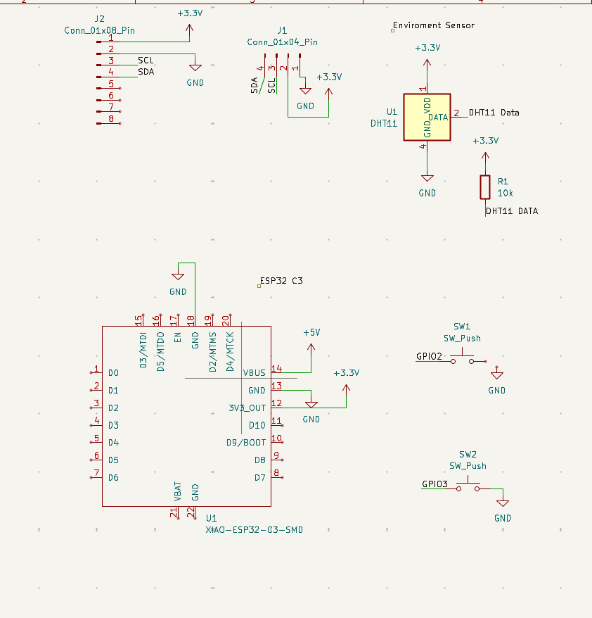
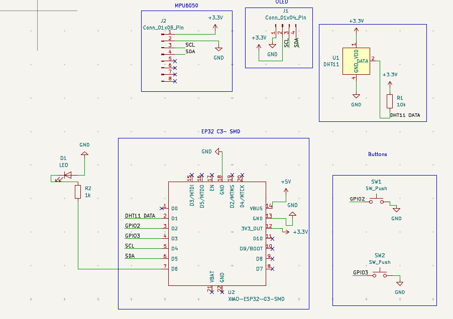
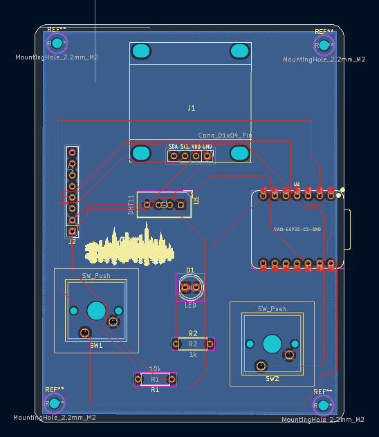
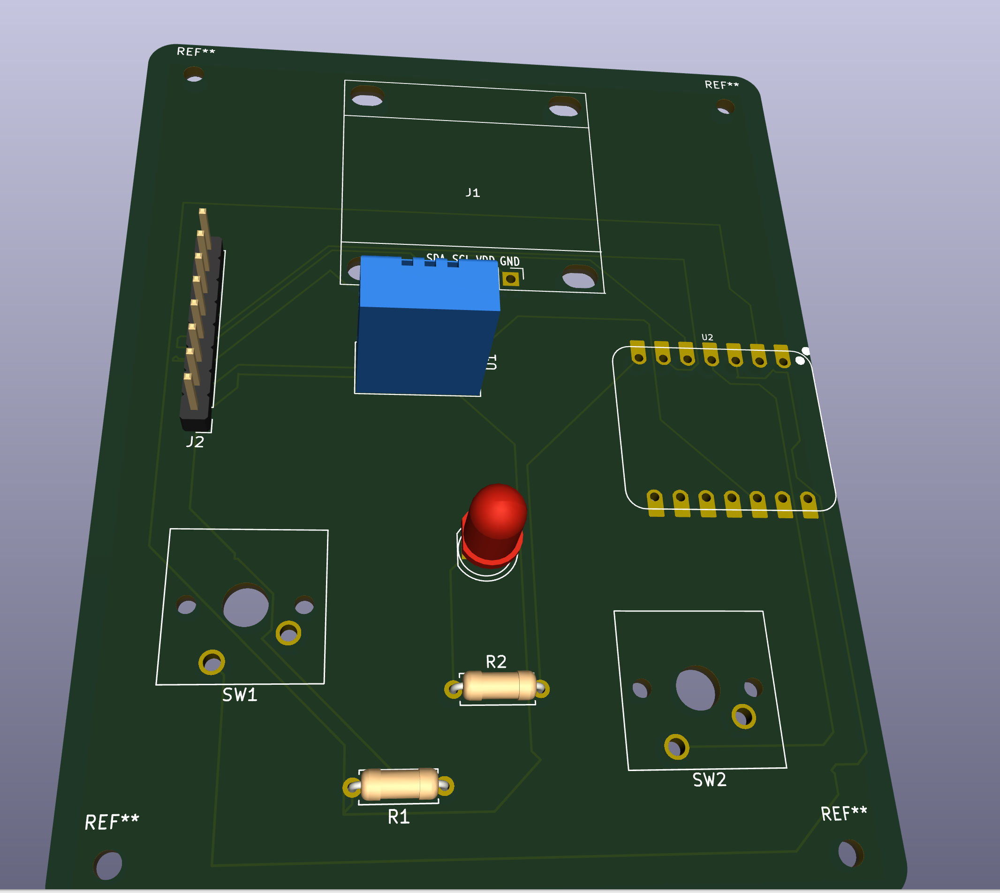
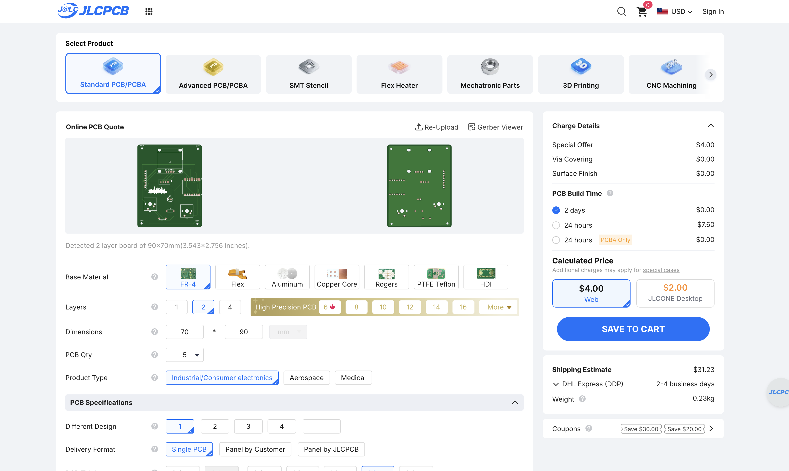

# NovaSense!!!
NovaSense is my first ever PCB design project that I have ever made! I was so exicted to make this project, and I can't wait to solder it! This ReadMe will explain the whole process I went through: 

## Hardware/Connections: 
### Components
- **Microcontroller**: Arduino-compatible board (e.g., NodeMCU, D1 Mini)
- **Display**: SSD1306 128x64 OLED screen (I2C interface)
- **Sensor**: DHT11 Temperature/Humidity sensor
- **Buttons**: 2x momentary push buttons (SW1, SW2)
- **LED**: Status indicator LED

### Pin Configuration
| Component | Pin |
|-----------|-----|
| Left Button (SW1) | D2 |
| Right Button (SW2) | D3 |
| LED | D6 |
| DHT11 Sensor | D1 |
| OLED SDA | D5 |
| OLED SCL | D4 |

### I2C Address
- OLED Display: `0x3C`

## Software Stack

- **Language**: C++ (Arduino)
- **Display Library**: Adafruit GFX + Adafruit SSD1306
- **Sensor Library**: Adafruit DHT
- **Communication**: I2C (Wire.h)
- **Baud Rate**: 115200 (Serial debugging)

## Project Structure

## MY JOURNAL:
### 
Started My First PCB Project!!!!

I started off by following the Starbie PCB design.
I did this by first downloading the KiCad software on my computer and connecting it to GitHub. After that, I watched 5 minutes of a 30 min youtube (its called Beginner's Guide to PCB Design in 30 Minutes by Tinkering Techie). I followed along to the instructions, and it took me ten whole minutes(lol): 

My diagrm from the Youtube Tutorial: 

After watching the video, and checking voer everything, I decided to move on to the Starbie Tutorial from Half Life( Note: I am only using the tutorial to leanr before starting my actual PCB project). 

I started with the first step of getting the Seeed Studio XIAO ESP32-C3 connected to the other components, like the DHT11 moudel. After connecting everything based on the guide, I ran the ERC to check if anything was wrong. I foudn a few errors of the GNd, and 5V, but with chatgpt's help I was able to fix them. 

Here is a image of the schestamatic that follows the guide:

Now I added my own two componets: Led, and resitor.I rewired everything to get this: 

After checking again with ERC, I fixed all the warnings, and wiring problems with the help of some people in # Half Life Help 

Finally I got to work on my PCB design, and move on from the shcestamtic. I first went to the edge cut layer, and made my design: 
 
            - A baisc sqaure curved design with two buttons on the side, and holes in all corners. 
                 - Includes the LCD on the top, and LED in the middle. 

After fixing the issues, I routed my wires, and used DRC to check any mistakes (I got 25 wanrings, and 2 errors)

I fixed this through the help of Half life help. I asked many people, and they told me that i had 4 uncconeted wires(silly me)

I fixed those, and got 2 errors and 18 warnigns, just like the guide(so this means nothing is wrong)

Here is my final PCB design(withut routing wires):

Finally, I did a 3d editor view, and got this; 

After that, I went to Arduino IDE go start my coding. Most of my coding details are in my journal in Half Life.( i provided all the information about the code there)
      1. I added liabries
      2. CHanged port to microcontroller XIAO 
      3. Made the code so that when you press a button: a led might light up, the hummity cgets dispaly on LCD, or "Hello might be prinnted on LCD. 
Next I uploaded a desing of new york city as a small feature. After that, I uplaoded my desing into JLCPCB and customized it based on that. 

Thats all! 

ALSO NOTE: For the money/costs, this is a screen shot for PCb design, since i didn't know how to share it for costs. 

Pleaase choose direct global shipping, and this: 

